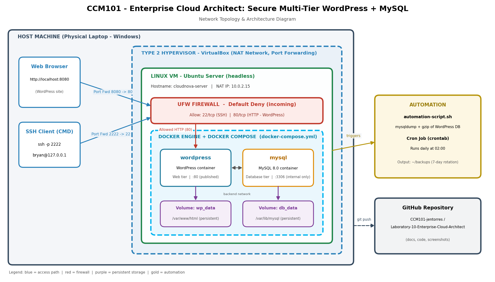

# Laboratory 10 – Enterprise Cloud Architect

**Project:** Secure Multi-Tier Web Application
**Stack:** WordPress + MySQL 8.0 (Docker Compose) on Ubuntu Server (VirtualBox)
**Course:** CCM101 – Cloud Computing

## Summary

A private, hardened, self-backing-up WordPress deployment for CloudNova Technologies.

| Requirement | Implementation |
|---|---|
| Base infrastructure | VirtualBox VM, Ubuntu Server, NAT with port forwarding |
| Multi-tier deployment | `wordpress` (web tier) + `mysql` (database tier) via `docker-compose.yml` |
| Persistent storage | Named volumes `db_data` and `wp_data` |
| Security | UFW, default deny incoming, only 22/tcp and 80/tcp allowed; DB not published |
| Automation | `automation-script.sh` (DB backup + 7-day rotation) scheduled by cron at 02:00 |
| Documentation | `operational-manual.md`, `final-reflection.md` |

## Architecture



## Quick start

```bash
git clone https://github.com/hellomaster00/CCM101-jentorres.git
cd CCM101-jentorres/Laboratory-10-Enterprise-Cloud-Architect
cp .env.example .env && nano .env      # set strong passwords
docker compose up -d
docker compose ps
chmod +x automation-script.sh
```

Open `http://localhost:8080` if running in the VirtualBox VM (port forwarded to port 80), or `http://<server-ip>` on a server with its own IP address. On KillerCoda, use the Traffic / Ports page and access port 80.

## Files

- `docker-compose.yml`: infrastructure as code
- `.env.example`: template for secrets (the real `.env` is never committed)
- `automation-script.sh`: database backup script
- `operational-manual.md`: handover manual
- `final-reflection.md`: Mission 1 to 10 reflection
- `screenshots/`: evidence used in the manual
