# CCM101 – Cloud Computing
## Enterprise Cloud Architect – Operational Manual

**Project:** Secure Multi-Tier Web Application
**Application Stack:** WordPress + MySQL
**Prepared by:** Bryan Sicat | [Glaiza Carmesis] | [Darlyn Mabutas] | [Rhon Jerald Sevilla] | [Alvinne Petina] 
**Section:** [BSIT 4-H]
**Instructor:** Jenkielyn C. Torres
**Date:** October 11 2026

---

## 1. Overview

This manual lets the client's IT team deploy, secure and maintain a WordPress site backed by MySQL. The stack runs in Docker containers on an Ubuntu Server VM, protected by UFW, with automatic daily database backups.

| Item | Value |
|---|---|
| Server name | `cloudnova-server` |
| OS | Ubuntu Server (headless) |
| Hypervisor | Oracle VirtualBox |
| VM network | NAT, `10.0.2.15` |
| Containers | `cloudnova-wordpress`, `cloudnova-mysql` |
| Volumes | `db_data`, `wp_data` |

> Credentials are never stored in this repository. Use your own values in `.env`.


## 2. Architecture Diagram


*Figure 1: Network topology at architecture ng Secure Multi-Tier WordPress + MySQL, mula sa host machine, VirtualBox, Ubuntu Server VM, UFW firewall, hanggang sa Docker containers at persistent volumes.*

Layers, top to bottom: Host laptop (browser) → VirtualBox → Ubuntu Server VM → UFW firewall → Docker network `backend` → containers → persistent volumes. The cron job and backup script run on the VM and write to `/home/bryan/backups`.

## 3. VM Setup and Networking

1. Create a VM in VirtualBox: Linux / Ubuntu 64-bit, 2048 MB RAM, 20 GB disk.
2. Attach the Ubuntu Server ISO and install. Hostname `cloudnova-server`, **tick "Install OpenSSH server"**.
3. After install, if SSH is missing: `sudo apt install -y openssh-server && sudo systemctl enable --now ssh`.
4. Settings → Network → Adapter 1 (NAT) → Port Forwarding:

| Name | Protocol | Host Port | Guest IP | Guest Port |
|---|---|---|---|---|
| SSH | TCP | 2222 | 10.0.2.15 | 22 |
| HTTP | TCP | 8080 | 10.0.2.15 | 80 |

5. From the host: `ssh -p 2222 bryan@127.0.0.1` and browse `http://localhost:8080`.

## 4. Docker Installation

```bash
sudo apt update && sudo apt upgrade -y
sudo apt install -y docker.io docker-compose-v2
sudo systemctl enable --now docker
sudo usermod -aG docker bryan
```

Log out and in again, then verify:

```bash
groups                      # must list docker
docker --version
docker compose version
docker run hello-world
```

## 5. Deployment

```bash
mkdir -p ~/wordpress-stack && cd ~/wordpress-stack
cp .env.example .env && nano .env     # set passwords
docker compose config                 # validate
docker compose up -d
docker compose ps
```

### docker-compose.yml explained

| Part | Purpose |
|---|---|
| `db` / `mysql:8.0` | Database tier |
| `wordpress` / `wordpress:latest` | Web tier |
| `depends_on: db` | Start order |
| `${...}` variables | Read from `.env`, so no secrets in the file |
| `db_data:/var/lib/mysql` | Persists the database |
| `wp_data:/var/www/html` | Persists WordPress files and uploads |
| `networks: backend` | Private network linking both containers |
| `ports: "80:80"` (wordpress only) | Only the web tier is exposed |
| `restart: unless-stopped` | Containers return after a reboot |

### Persistence test

Publish a post, run `sudo reboot`, log in again, run `docker compose ps`. Both containers return as `Up` and the post is still present.

## 6. Security

```bash
sudo ufw default deny incoming
sudo ufw default allow outgoing
sudo ufw allow 22/tcp comment 'SSH'
sudo ufw allow 80/tcp comment 'WordPress HTTP'
sudo ufw enable
sudo ufw status verbose
```

| Control | Reason |
|---|---|
| Default deny incoming | Anything not explicitly allowed is blocked |
| Allow 22/tcp | Remote administration |
| Allow 80/tcp | The web application |
| MySQL has no `ports:` entry | Reachable only inside the Docker network |
| `.env` excluded from Git | Secrets stay out of the repository |

**Note:** Docker-published ports can bypass UFW, so only port 80 is published.

**Known limitation:** `mysqldump -p` prints a warning that passwords on the command line are insecure. For production, use a MySQL option file or Docker secrets.

## 7. Automation

`automation-script.sh` dumps the WordPress database, compresses it to `/home/bryan/backups/wordpress_db_<timestamp>.sql.gz`, deletes backups older than 7 days, and logs to `backup.log`.

```bash
chmod +x automation-script.sh
./automation-script.sh        # manual test
crontab -e
```

Cron entry (daily at 02:00, VM time is UTC):

```
0 2 * * * /home/bryan/wordpress-stack/automation-script.sh
```

Verify with `crontab -l`, `cat ~/backups/backup.log`, `ls -lh ~/backups`.

## 8. Maintenance and Troubleshooting

**Restore a backup**

```bash
gunzip < ~/backups/<file>.sql.gz | docker exec -i cloudnova-mysql mysql -u root -p wordpress
```

**Common tasks**

| Task | Command |
|---|---|
| Status | `docker compose ps` |
| Logs | `docker compose logs -f wordpress` / `db` |
| Update images | `docker compose pull && docker compose up -d` |
| Stop (keep data) | `docker compose down` |
| Stop and delete data | `docker compose down -v` (destructive) |
| Firewall status | `sudo ufw status verbose` |

**Problems we met and fixed**

| Problem | Cause | Fix |
|---|---|---|
| SSH "Connection aborted" | OpenSSH server not installed | `sudo apt install openssh-server` |
| VirtualBox "port forwarding rules not valid" | Bad character in an IP cell | Clear the cell or leave IPs blank |
| `yaml: unmarshal errors ... already defined` | Compose content pasted twice | Recreate the file once with `cat > ... << 'EOF'` |
| `permission denied ... docker.sock` | User not in `docker` group | `sudo usermod -aG docker bryan`, then re-login |
| `connection reset by peer` during pull | Unstable network | Re-run `docker compose up -d`; layers resume |
| DB password change has no effect | Old password stored in `db_data` | Use `docker compose down -v` on a fresh setup only |


## 9. Evidence (Screenshots)

### 9.1 Port Forwarding
*Figure 1: Port forwarding configuration para ma-access ang WordPress mula sa labas ng VM.*

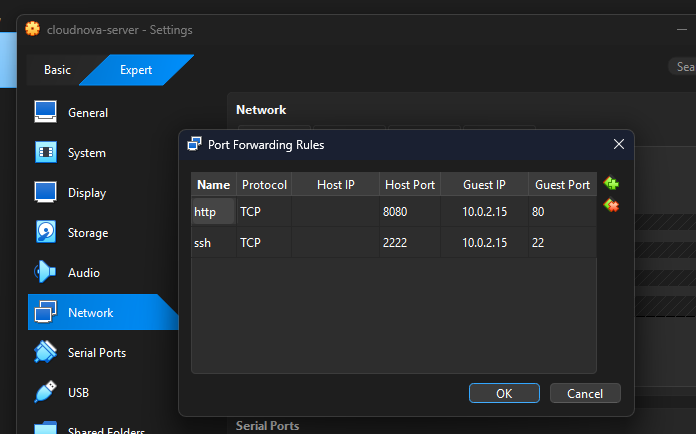

### 9.2 Docker Compose Status
*Figure 2: Output ng `docker compose ps` na nagpapakitang running ang mga container.*


### 9.3 WordPress Dashboard
*Figure 3: WordPress admin dashboard pagkatapos ng successful installation.*


### 9.4 Data Persistence
*Figure 4: Test post na nanatili pa rin matapos i-restart ang mga container.*

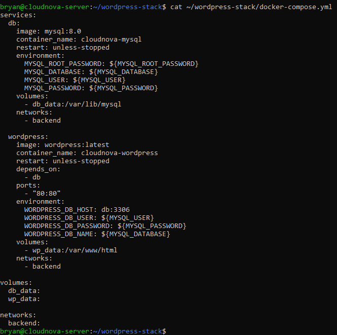

### 9.5 Firewall Status
*Figure 5: UFW status na nagpapakita ng mga allowed na port.*

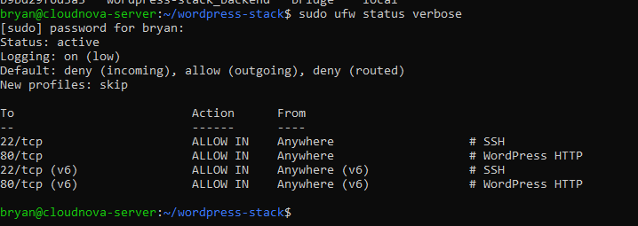

### 9.6 Backup Test
*Figure 6: Resulta ng backup test gamit ang automation script.*

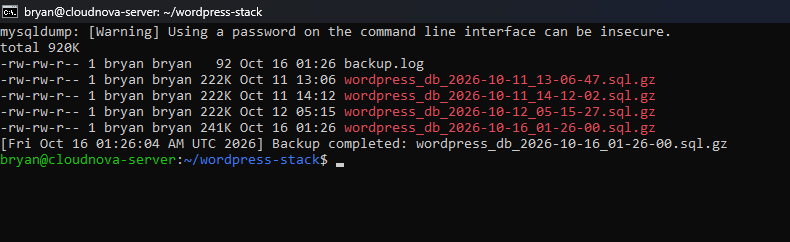

### 9.7 Scheduled Backup (Cron)
*Figure 7: Crontab entry para sa automated na backup.*

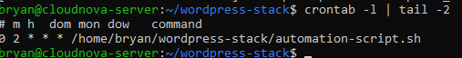

### 9.8 Docker Volumes
*Figure 8: Listahan ng Docker volumes na ginagamit para sa persistent storage.*

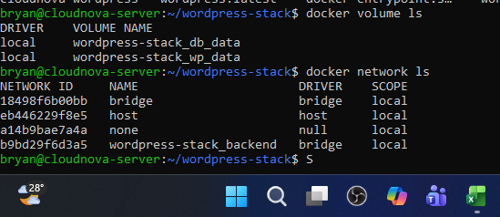

### 9.9 Hypervisor Settings (VM 01)
*Figure 9: Hypervisor settings ng VM 01.*

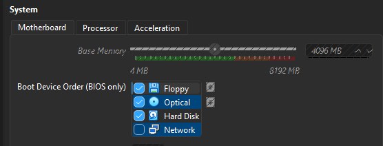

### 9.10 Hypervisor Settings (VM 02)
*Figure 10: Hypervisor settings ng VM 02.*

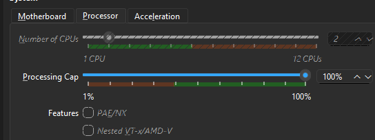

### 9.11 Network Configuration (VM 03)
*Figure 11: Network configuration ng VM 03.*

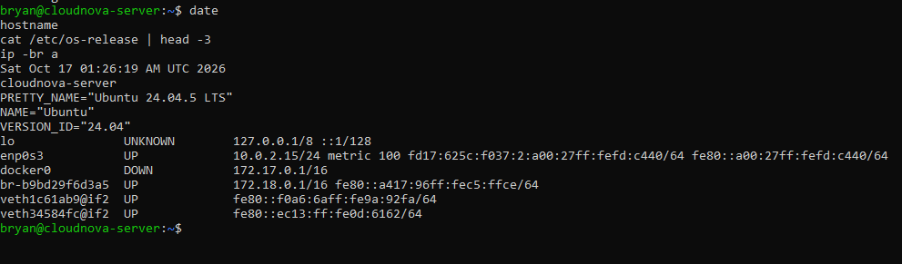

### 9.12 Storage Settings (VM 03)
*Figure 12: Storage settings ng VM 03.*

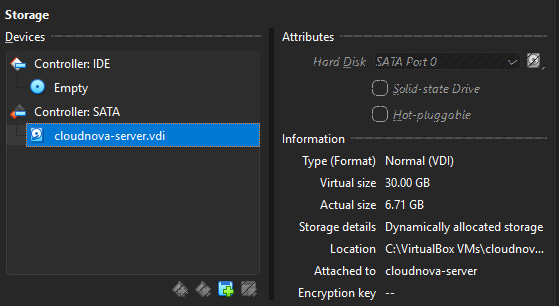

### 9.13 Network Information
*Figure 13: Network information ng VM matapos ang configuration.*

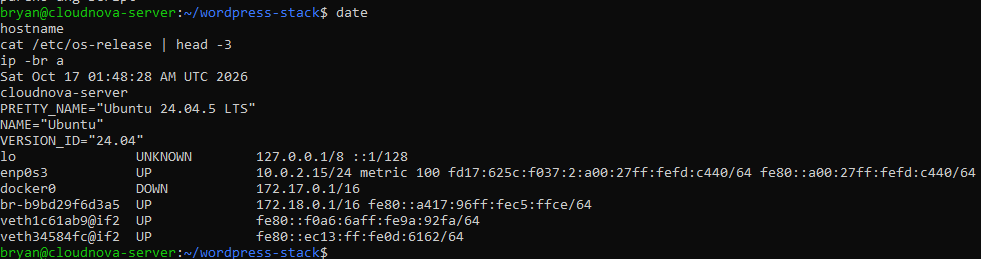

### 9.14 VM Reboot
*Figure 14: Pag-reboot ng VM gamit ang `sudo reboot` para ma-apply ang mga pagbabago.*

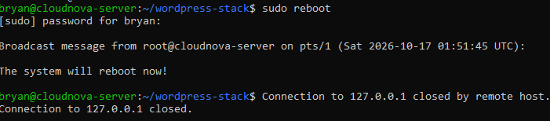


## 10. Restoration

### 10.1 Restore Test: Before (Post Deleted)
*Figure 15: Estado ng WordPress site bago ang restore, kung saan wala na ang test post.*

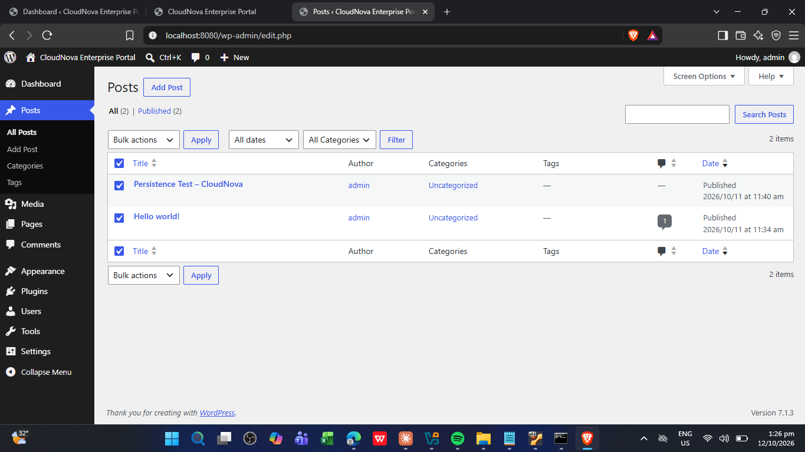

### 10.2 Restore Test: Restore Command
*Figure 16: Command na ginamit para i-restore ang database mula sa backup.*

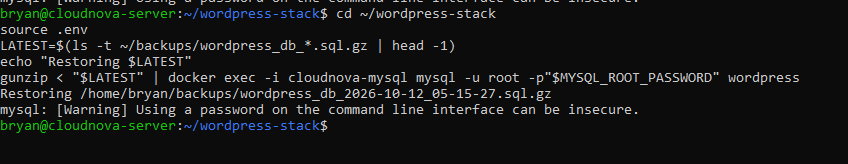

### 10.3 Restore Test: After (Post Recovered)
*Figure 17: Bumalik na ang test post pagkatapos ng restore, na nagpapatunay na gumagana ang backup.*

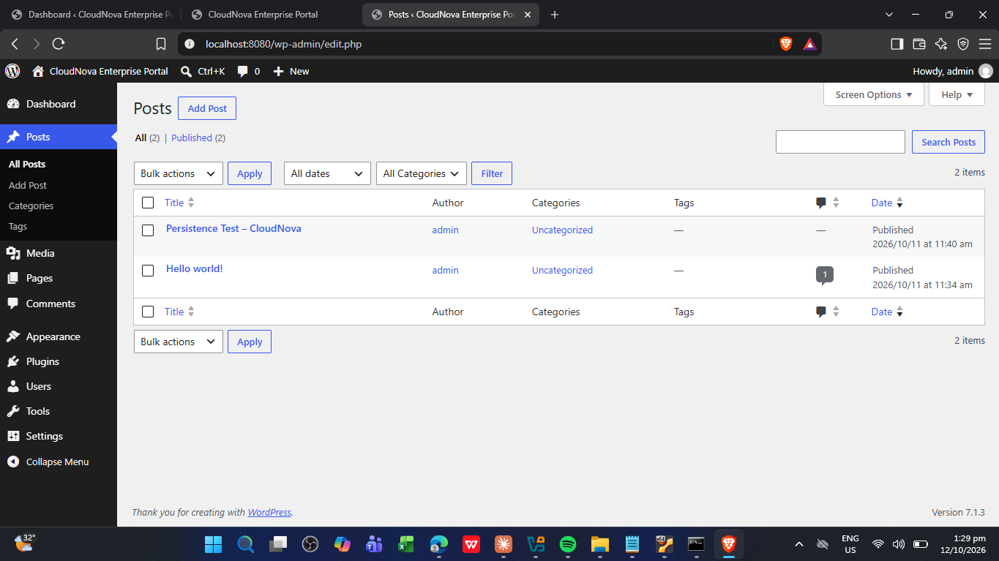


## 11. KillerCoda (Screenshots)

### 11.1 Docker Installation Verification
*Figure 18: Output ng `docker --version` at `docker compose version` na nagpapakita ng naka-install na Docker 29.1.3 at Docker Compose 2.40.3.*

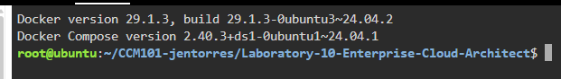

### 11.2 MySQL Database Readiness Check
*Figure 19: Output ng `docker compose logs db` na may filter na "ready for connections", na nagpapakita na handa na ang MySQL 8.0.46 ng `cloudnova-mysql` container sa port 3306 at ang X Plugin sa port 33060.*

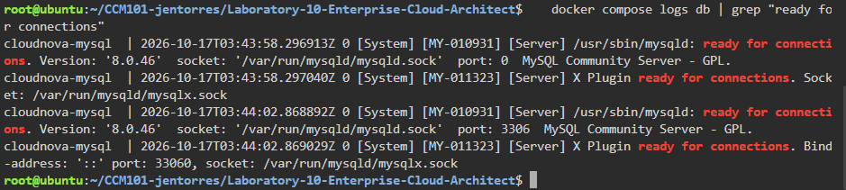

### 11.3 WordPress Initial Installation Page
*Figure 20: WordPress installation wizard (`/wp-admin/install.php`) na nagpapakita ng language selection, na nagpapatunay na matagumpay na na-deploy ang WordPress container at naa-access ito sa pamamagitan ng public URL.*

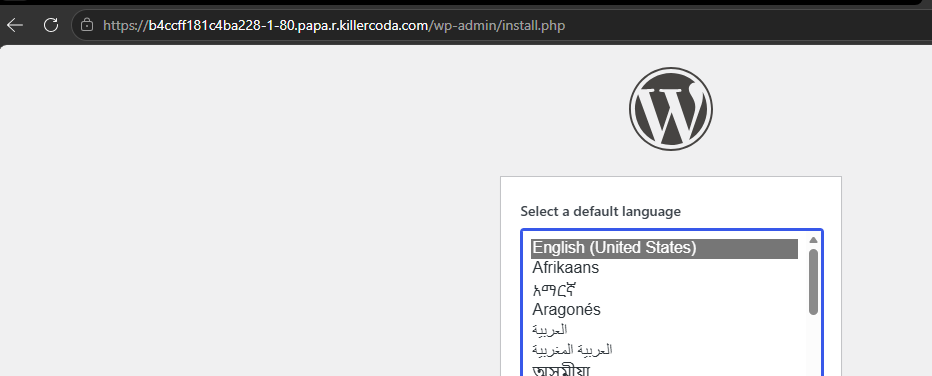

### 11.4 WordPress Admin Post Editor
*Figure 21: WordPress block editor na nagpapakita ng default na "Hello world!" post, na nagpapatunay na matagumpay ang installation at naka-login na ang admin sa site.*

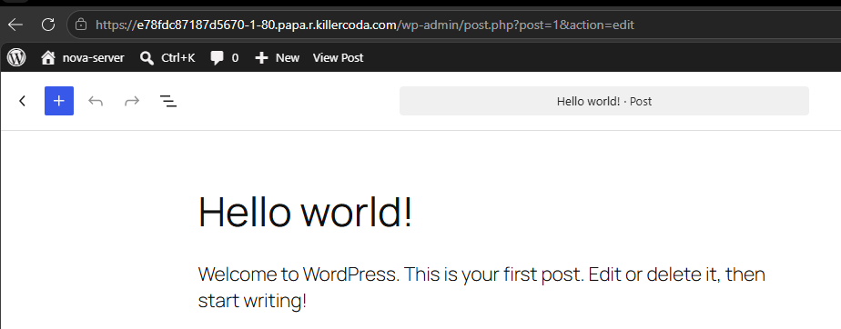

### 11.5 WordPress Test Post Verification
*Figure 22: Published na "Defense Test Post" sa WordPress site na nabubuksan sa browser, na nagpapatunay na gumagana ang WordPress at ang koneksyon nito sa database.*

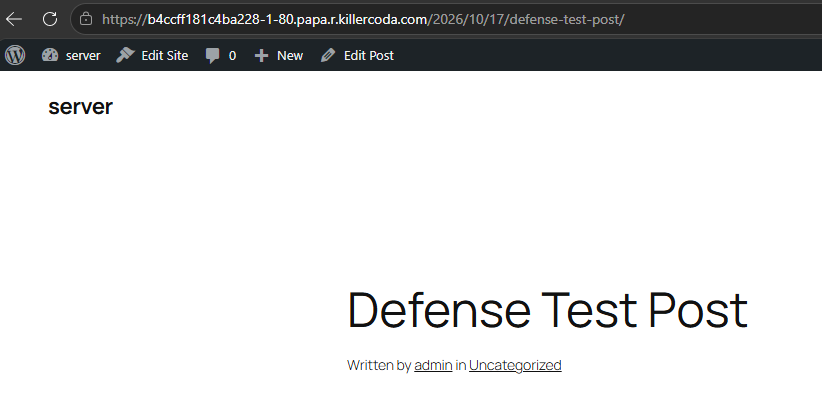

### 11.6 Container Recreation and Volume Persistence Test
*Figure 23: Pag-remove at pag-recreate ng `cloudnova-mysql` at `cloudnova-wordpress` containers, kung saan nanatili ang `db_data` at `wp_data` volumes, at muling nag-start ang dalawang container.*

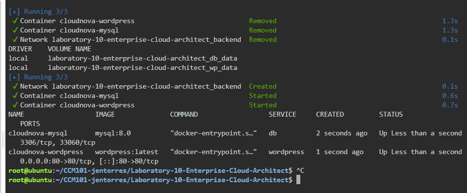

### 11.7 UFW Firewall Configuration
*Figure 24: Active na UFW firewall na may default na `deny` para sa incoming traffic, at pinapayagan lang ang port 22/tcp (SSH) at 80/tcp (HTTP) sa IPv4 at IPv6.*

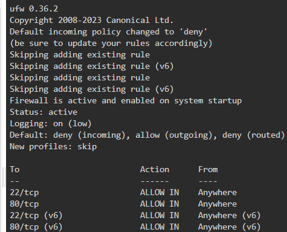

### 11.8 Automation Script Permissions and Manual Test Run
*Figure 25: Executable na `automation-script.sh` (`-rwxr-xr-x`) at ang resulta ng manual na pag-run nito, kung saan nag-output ang `mysqldump` ng warning tungkol sa paggamit ng password sa command line.*

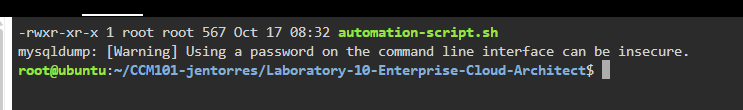

### 11.9 Cron Job Scheduling and Service Status
*Figure 26: Cron entry na nagpapatakbo ng `automation-script.sh` araw-araw ng 2:00 AM, at ang `cron.service` na active (running) at naka-enable.*

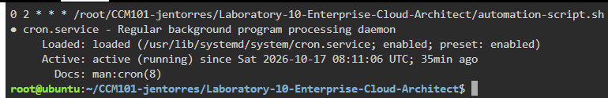

### 11.10 Containers Running
*Figure 27: Output ng `docker compose ps` na nagpapakita ng `cloudnova-mysql` at `cloudnova-wordpress` containers na running sa KillerCoda.*

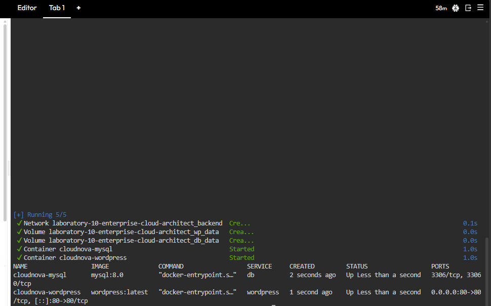

### 11.11 WordPress via Traffic / Ports
*Figure 28: WordPress site na nabubuksan sa browser sa pamamagitan ng Traffic / Ports ng KillerCoda (port 80).*

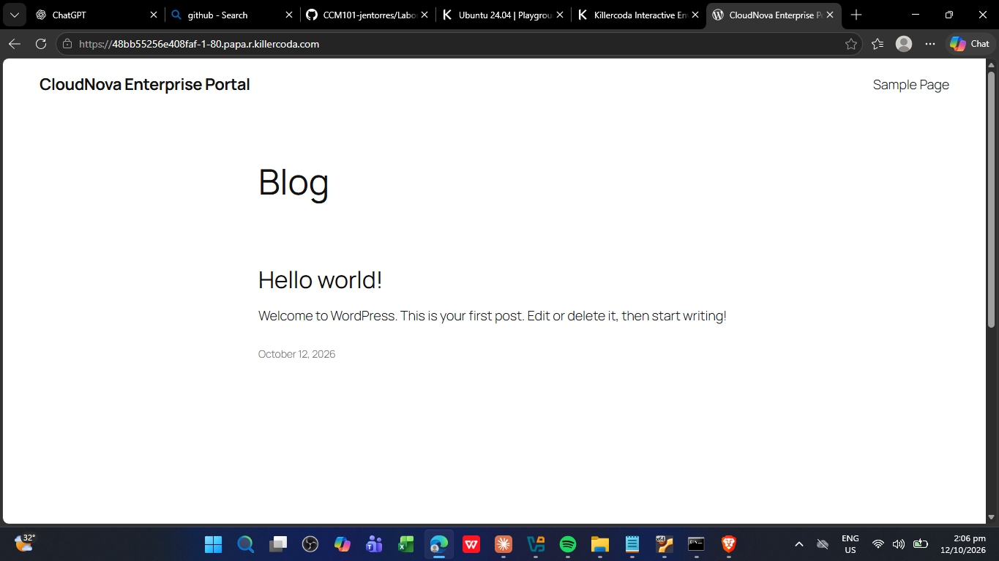

### 11.12 UFW Status
*Figure 29: Status ng UFW firewall sa KillerCoda na nagpapakita ng mga active na rule para sa incoming traffic.*

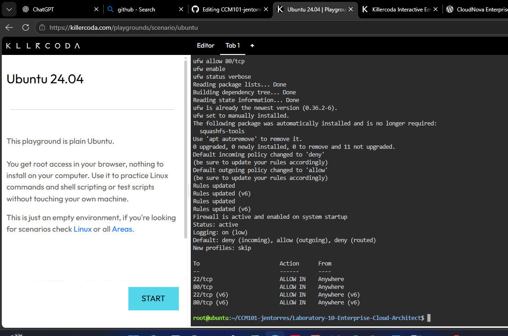

### 11.13 Backup Run and Cron Proof
*Figure 30: Manual na pag-run ng backup script at patunay na naka-schedule ito sa cron.*

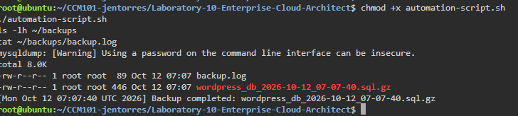

### 11.14 Crontab
*Figure 31: Crontab entry na nagpapatakbo ng automated na backup sa takdang oras.*

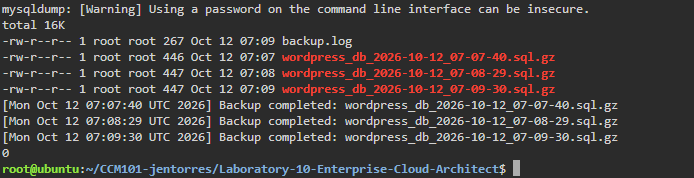


